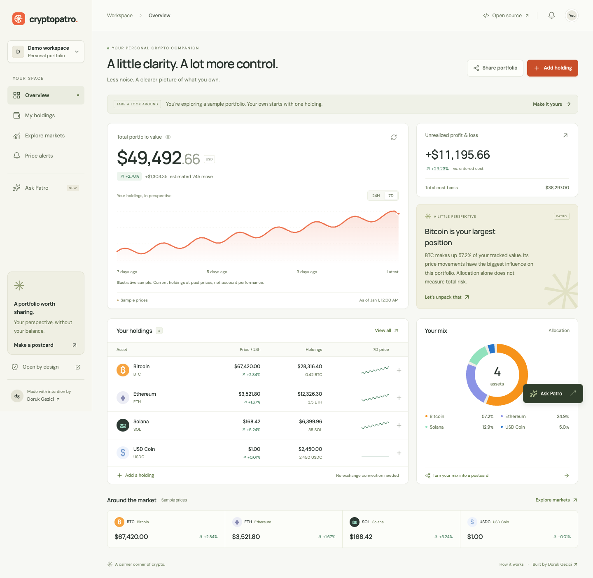

# CryptoPatro

**Your crypto, a little clearer.** A calm, open-source portfolio workspace by [Doruk Gezici](https://github.com/dorukgezici).

Track holdings, understand your allocation, and turn your portfolio mix into a shareable snapshot. Built with FastAPI, Pydantic AI, Astro, and React. The project runs without exchange credentials or an AI key.



## What works

- An immediate sample portfolio, with a clear path to starting your own.
- Private holdings with quantities and average purchase prices, persisted in SQLite.
- Current valuation, unrealized return, allocation, and clearly labeled market freshness.
- CoinGecko quotes with cached data and an explicit illustrative fallback when the provider is unavailable.
- A portfolio copilot that explains concentration, cost basis, and in-app alerts. Pydantic AI classifies questions when configured; trusted code calculates every portfolio fact. Without a provider it gives a labeled local summary.
- In-app price alerts checked when you open or refresh them.
- Public allocation snapshots that omit balances, quantities, cost basis, and portfolio access tokens. Personal snapshots can be revoked; anonymous sample postcards cannot. Share pages credit the maker and invite visitors to create their own mix.
- Responsive, keyboard-accessible views with self-hosted fonts and social preview images.

This release is a manual portfolio tracker. It does not connect exchanges, hold funds, execute trades, send Telegram messages, or provide tax accounting. Charts revalue current quantities at historical asset prices; they do not reconstruct actual account history. The product and launch strategy is in [docs/product-strategy.md](docs/product-strategy.md).

## Run locally

Requirements: Node.js 26.11.1, Python 3.15.0, and [uv](https://docs.astral.sh/uv/getting-started/installation/) 0.13.0. Exact dependency versions and the TypeScript compatibility arrangement are documented in [docs/versions.md](docs/versions.md).

Start the backend in one terminal:

```sh
cd backend
uv sync --frozen
uv run uvicorn cryptopatro.main:app --reload --host 127.0.0.1 --port 8000
```

Start the frontend in another:

```sh
cd frontend
npm ci
npm run dev
```

Open [localhost:4321](http://localhost:4321). API documentation is at [localhost:8000/docs](http://localhost:8000/docs), and health is at [localhost:8000/api/health](http://localhost:8000/api/health). No environment file is required for local summaries and sample mode. Live prices require access to CoinGecko's public API.

### Optional AI

Set `CRYPTOPATRO_AI_MODEL` to an available OpenAI model in Pydantic AI's `openai:MODEL_ID` format and supply `OPENAI_API_KEY` in the backend environment. Restart the backend after configuring them. The app works without these values, and provider errors fall back to local summaries. AI mode routes the question; it does not generate unchecked balances, predictions, or trading recommendations.

### Configuration

| Variable | Default | Purpose |
| --- | --- | --- |
| `BACKEND_URL` | `http://127.0.0.1:8000` | Frontend server's private upstream. Docker sets this to `http://backend:8000`. |
| `PUBLIC_SITE_URL` | Current request origin | Canonical public origin and social image URLs. Set to your HTTPS domain when deployed. |
| `CRYPTOPATRO_DATABASE_PATH` | `data/cryptopatro.sqlite3` | Backend SQLite file. |
| `CRYPTOPATRO_CORS_ORIGINS` | Local frontend origins | JSON array of allowed origins for direct backend access. |
| `CRYPTOPATRO_TRUST_PROXY_HEADERS` | `false` | Enable only behind the controlled frontend proxy. Compose enables this while keeping the API off public interfaces. |
| `CRYPTOPATRO_RATE_LIMIT_MODE` | `client_ip` | Use `shared_proxy` when ingress hides visitor IPs. Portfolio quotas and service capacity limits remain active in both modes. |
| `CRYPTOPATRO_MARKET_ENABLED` | `true` | Set `false` for deterministic sample prices and offline testing. |
| `CRYPTOPATRO_AI_MODEL` | Unconfigured | Optional Pydantic AI model identifier. |
| `OPENAI_API_KEY` | Unconfigured | Server-only AI provider credential. |

Browsers call `/api` on the frontend origin. The same Astro endpoint forwards requests to FastAPI in development and production. This keeps provider credentials and the backend origin out of the browser bundle.

Rate limits distinguish authenticated portfolios from anonymous traffic; neither tokens nor IPs identify unique people. Optional AI has persistent hourly and daily run budgets plus a concurrency limit. When that budget is unavailable, chat returns a labeled local summary. See [capacity configuration](backend/RATE_LIMITS.md) for exact defaults and their limits.

## Run with Docker

```sh
docker compose up --build
```

Open [localhost:4321](http://localhost:4321). Both services have healthchecks. A named volume stores SQLite across container restarts. API documentation is exposed only on the host's loopback interface at port 8000. Copy `.env.example` to `.env` to change the frontend port, public URL, or optional AI settings.

For a public deployment, put the frontend behind HTTPS, set `PUBLIC_SITE_URL` to the real origin, and retain a persistent backend volume with backups. The current SQLite deployment is designed for one backend instance. Do not scale it to separate ephemeral disks.

The [production chart](backend/helm/README.md) targets the existing Argo CD application and HTTPS host `cryptopatro.pub.gezici.me`. The replacement passed an isolated preview in the existing k3s cluster, including restart persistence on Longhorn. The chart uses `shared_proxy` capacity controls because the existing ingress hides visitor IPs; it requires no shared infrastructure change. Production still serves the legacy application pending verification and promotion of the revised release. See the [verification report](docs/verification.md) for the exact evidence.

The Python 3.15 runtime is installed by uv on Debian Trixie because the official `python:3.15.0-slim` Docker tag was not yet published at verification time.

## Privacy and data

A random bearer token identifies each private portfolio and is stored in the browser's local storage. Anyone with that token can access the portfolio. There is no email account or password recovery; clearing browser storage without keeping the token loses access. Public sharing is an explicit action, and a share's public data is a saved snapshot. Reopen the share dialog to see and revoke your previously published personal postcards. Anonymous sample postcards cannot be revoked. Revocation removes access through CryptoPatro but cannot remove already downloaded images or third-party caches.

Market data is informational. Sample quotes are labeled, and sample prices do not trigger personal price alerts. Unrealized return compares current valuation with entered average costs and excludes fees, disposals, and taxes.

## Growth measurement

The share loop measures simple aggregate events instead of advertising identifiers. Read the report from a backend with existing data:

```sh
cd backend
uv run python -m cryptopatro.growth
```

Use `--database /path/to/cryptopatro.sqlite3` to inspect another database. The command opens SQLite read-only and reports event totals for the trailing 7 and 30 days in UTC, plus current public postcard totals split between sample and personal portfolios. It does not output access tokens, balances, IPs, or postcard links.

`portfolio_activated` is recorded once when a portfolio gains its first manually entered holding. `referral_activated` records that same first holding when the portfolio came through a valid postcard referral. Maker clicks and share interactions help assess whether people reach Doruk's work. Counts describe recorded events, not verified unique visitors.

## Verify

```sh
cd backend
uv run ruff check .
uv run pytest
```

```sh
cd frontend
npm run typecheck
npm run build
```

The API contract is in [docs/api-contract.md](docs/api-contract.md). CI runs backend checks, a production frontend build, and browser tests on pushes and pull requests. [Browser test instructions](frontend/tests/README.md) explain the isolated, offline Playwright suite and its desktop/mobile screenshots.

The [verification report](docs/verification.md) records the end-to-end checks for this rebuild.

## License

[GNU General Public License v3](LICENSE). Fonts retain their bundled open font licenses.
